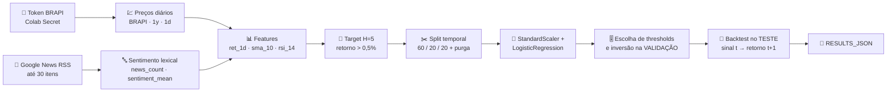

<div align="center">

# 📈 Indicadores Técnicos + Sentimento de Notícias para Sinais de Negociação

### Um experimento com validação temporal em ITUB4, PETR4 e VALE3


**Autora:** Giselle de Araujo Brasileiro · **Código:** `pipeline_validacao_temporal_3tickers.py` · **Data:** 30/10/2026

</div>

> [!WARNING]
> Este projeto é um **experimento acadêmico**. Não é aconselhamento financeiro, não envia ordens reais à bolsa e os resultados históricos **não são promessa de desempenho futuro**.

---

## 📑 Sumário

- [Resumo executivo](#-resumo-executivo)
- [Pergunta de pesquisa](#-pergunta-de-pesquisa)
- [Vocabulário](#-vocabulário)
- [Arquitetura do pipeline](#️-arquitetura-do-pipeline)
- [Construção dos dados](#-construção-dos-dados)
- [O que o modelo prevê](#-o-que-o-modelo-prevê)
- [Modelo e regra de negociação](#-modelo-e-regra-de-negociação)
- [Backtest](#-backtest)
- [Resultados da execução atual](#-resultados-da-execução-atual)
- [Execução anterior vs. atual](#-execução-anterior-vs-atual)
- [Evolução experimental](#-evolução-experimental)
- [Baseline D+1](#-baseline-d1)
- [Como executar no Colab](#-como-executar-no-colab)
- [Limitações e trabalhos futuros](#-limitações-e-trabalhos-futuros)

---

## 🧾 Resumo executivo

O protótipo baixa **preços** e **notícias**, transforma essas fontes em variáveis, define um resultado futuro a classificar, ajusta um modelo, **escolhe uma regra de negociação na validação** e mede essa regra num **bloco posterior de teste**.

| Ticker | Estratégia (teste) | Buy & Hold (teste) | Veredito |
|:------:|:------------------:|:------------------:|:---------|
| **ITUB4** | 1,0758 (**+7,58%**) | 1,2588 (**+25,88%**) | 🔴 Abaixo do benchmark |
| **PETR4** | 1,3218 (**+32,18%**) | 1,3612 (**+36,12%**) | 🔴 Abaixo do benchmark |
| **VALE3** | 1,0000 (**0,00%**) | 0,8582 (**−14,18%**) | ⚪ Sem posição durante a queda |

> [!IMPORTANT]
> - VALE3 **não abriu posição**: ficar em 1,0 enquanto o benchmark caía não demonstra uma estratégia ativa lucrativa.
> - A separação treino/validação/teste melhora a disciplina experimental, mas há uma limitação: o modelo prevê o retorno de **5 pregões**, enquanto o backtest aplica o sinal ao retorno do **dia seguinte**.

**Conclusão:** não há demonstração de uma estratégia que supere de forma consistente o Buy & Hold nos três ativos.

---

## ❓ Pergunta de pesquisa

> É possível combinar indicadores de preço e notícias para gerar sinais simulados de **compra (BUY)**, **saída (SELL)** ou **manutenção (HOLD)**, e como esses sinais se comparam a comprar a ação no início e mantê-la?

---

## 📖 Vocabulário

| Termo | Explicação sem jargão |
|---|---|
| **Ticker** | Código que identifica a ação, por exemplo `PETR4`. |
| **Feature** | Dado numérico que o modelo recebe: retorno, RSI, número de notícias etc. |
| **Target / alvo** | A resposta que queremos que o modelo estime. |
| **Treino** | Período antigo usado para ajustar o modelo. |
| **Validação** | Período usado para escolher a regra/limiares antes da avaliação final. |
| **Teste** | Período posterior reservado para medir a regra já escolhida. |
| **Threshold / limiar** | Corte de probabilidade que decide quando entrar ou sair da posição. |
| **Backtest** | Simulação histórica de uma regra; não coloca ordens na bolsa. |
| **Buy & Hold** | Comprar no começo e manter; referência de comparação. |
| **Overfitting** | Quando as escolhas se ajustam demais ao histórico e não generalizam. |
| **Purga** | Intervalo removido entre blocos para que rótulos futuros não atravessem a fronteira. |

---

## 🏗️ Arquitetura do pipeline



O código foi organizado em **funções pequenas**, cada uma com uma responsabilidade fácil de testar. Se a fonte de preços mudar, revisa-se só a função de preços; se a regra de decisão mudar, altera-se o backtest sem mexer no parser RSS.

| Função / bloco | O que faz | Por que foi separado assim |
|---|---|---|
| `Configuração` | Define tickers, horizonte, fonte, grids e custo. | Deixa as escolhas experimentais visíveis e reproduzíveis. |
| `get_brapi_token` | Busca o segredo do Colab ou solicita o token escondido. | Evita escrever credencial no código público. |
| `brapi_quote_historical` | Baixa e limpa fechamentos diários. | Isola a integração de preço e trata ausência de dados. |
| `rss_url` / `parse_rss` | Monta a consulta e extrai campos do XML RSS. | Separa busca de parsing. |
| `simple_sentiment_pt` / `news_features` | Cria o score lexical e agrega notícias por data. | Transforma texto em colunas numéricas simples. |
| `rsi` / `build_features_targets` | Calcula features de preço e o target futuro. | Torna explícita a janela dos indicadores e a variável a prever. |
| `backtest_next_day` | Aplica o sinal da data *t* ao retorno de *t* até *t+1*. | Evita usar o retorno do dia antes de o sinal existir. |
| `choose_thresholds` | Testa combinações na validação e guarda a melhor. | Mantém o teste fora da seleção da regra. |
| `run_one_ticker` / `run` | Executa o fluxo por ativo e imprime JSON. | Permite comparar tickers com saída estruturada. |

---

## 🗂️ Construção dos dados

### 💹 Preços — BRAPI

`brapi_quote_historical` chama a BRAPI com `PRICE_RANGE="1y"` e `PRICE_INTERVAL="1d"`. O código conserva **data** e **close**, converte o preço para número, remove fechamentos ausentes e ordena as datas. Se a fonte não retornar preços ou faltar uma coluna esperada, devolve uma tabela vazia, evitando falhas silenciosas adiante.

> [!CAUTION]
> O token é uma credencial. Ele é lido do Secret `BRAPI_TOKEN` do Colab (ou digitado sem eco) e **nunca** deve aparecer no README, notebook público ou repositório.

### 📰 Notícias — Google News RSS

`rss_url` monta a consulta com o ticker como termo; `parse_rss` percorre os itens e recupera **título, descrição, data e link**. Se o XML não puder ser lido, retorna tabela vazia com as colunas esperadas. O limite é de **30 notícias por ticker**.

> [!NOTE]
> O RSS **não é uma base histórica completa**. Os itens variam com o tempo, e muitas datas antigas ficam sem notícia associada (recebem zero). O modelo **não** teve uma série de sentimento completa e comparável ao preço durante todo o ano.

### 🔤 Do texto aos números

`simple_sentiment_pt` limpa pontuação, separa palavras e verifica se cada termo está numa lista pequena de vocabulário positivo ou negativo:

$$
\text{score} = \frac{\text{positivas} - \text{negativas}}{\text{total reconhecido}}
$$

Exemplo: 2 positivas e 1 negativa → $(2-1)/(2+1) = 1/3$. Sem palavras reconhecidas, o score é zero. `news_features` agrega por data, gerando `news_count` e `sentiment_mean`.

O método foi escolhido por **simplicidade, velocidade e explicabilidade**, mas não entende negação (“não subiu”), ironia, contexto, duplicatas nem relevância. É uma *baseline* didática.

### 📊 Indicadores de preço

| Variável | Como ler | Decisão de projeto |
|---|---|---|
| `ret_1d` | Variação do fechamento em relação ao pregão anterior. | Captura o movimento recente de um dia. |
| `sma_10` | Média dos dez fechamentos mais recentes. | Suaviza oscilações curtas. |
| `rsi_14` | Movimentos recentes de alta e baixa numa janela de 14. | Informação sintética de *momentum*. |
| `news_count` | Quantidade de notícias na data. | Volume de cobertura como sinal simples. |
| `sentiment_mean` | Média dos scores lexicais do dia. | Orientação lexical rudimentar. |

---

## 🎯 O que o modelo prevê

**Baseline D+1.** A primeira hipótese era prever se o próximo dia teria retorno positivo — fácil de entender, mas muito ruidoso (ver [Baseline D+1](#-baseline-d1)).

**Horizonte H=5 com margem de 0,5%.** Na versão atual:

$$
\text{future\_ret}_H = \frac{\text{close}(t+5)}{\text{close}(t)} - 1
\qquad
\text{target} =
\begin{cases}
1 & \text{se } \text{future\_ret}_H > 0{,}005 \\
0 & \text{caso contrário}
\end{cases}
$$

- `FILTER_NEUTRAL=False`: pequenas altas, estabilidade e quedas ficam na classe 0.
- As últimas datas **sem preço futuro ficam sem target e são removidas**.
- A **purga de 5 linhas** antes de cada fronteira impede que a janela de rotulagem invada o bloco seguinte.

A mudança de horizonte não garante melhor previsão: ela **altera a pergunta** do experimento e a distribuição dos rótulos.

---

## 🤖 Modelo e regra de negociação

### Divisão temporal e padronização

```text
|◄──────── 60% treino ────────►|purga|◄─ 20% validação ─►|purga|◄─ 20% teste ─►|
             passado  ───────────────────────────────────────────►  futuro
```

- A ordem passado → futuro é respeitada (sem embaralhamento).
- `StandardScaler` é ajustado **só no treino** e aplicado à validação e ao teste.
- `LogisticRegression` produz `p_up`, a probabilidade estimada da classe positiva.

### Métricas de classe ≠ backtest

Com corte fixo de 0,5 são calculadas **accuracy, precision, recall, F1 e ROC-AUC**. Elas avaliam a **classificação**, não o retorno financeiro da regra.

### Thresholds BUY / SELL / HOLD

| Condição | Ação |
|---|---|
| `p ≥ buy_thr` | 🟢 **BUY** — abre posição |
| `p ≤ sell_thr` | 🔴 **SELL** — zera posição |
| entre os limiares | 🟡 **HOLD** — mantém a posição anterior |

```python
BUY_GRID  = [0.55, 0.60, 0.65]
SELL_GRID = [0.45, 0.40, 0.35]   # pares com sell >= buy são rejeitados
```

### Inversão e seleção na validação

O código testa `p_up` e `1 - p_up` (`roc_auc_inverted`). `choose_thresholds` roda o backtest de cada combinação **na validação**, guarda a de maior fator de patrimônio e **congela** essa regra para o teste.

> [!NOTE]
> A inversão é só uma hipótese para aquele histórico; não prova que a direção oposta persistirá.

---

## 🧪 Backtest

`backtest_next_day` calcula `next_return = close(t+1)/close(t) - 1` e aplica o sinal de *t* a esse retorno.

- Mudança de posição → patrimônio × `(1 - FEE_PER_TRADE)`, com `fee = 0.0005`.
- Posição comprada → aplica o retorno do dia seguinte.
- Buy & Hold multiplica todos os retornos da mesma janela.
- `trades_approx` conta mudanças de posição (não ordens reais).

| ✅ Corrigido | ⚠️ Ainda pendente |
|---|---|
| O sinal não é mais aplicado a um retorno que já aconteceu antes dele. | O target é de **5 dias**, mas a estratégia captura o retorno de **1 dia**. Não medem a mesma pergunta econômica. |
| | Custo fixo não representa slippage, spread, impostos, liquidez, execução parcial ou impacto de mercado. |

> [!TIP]
> **Fatores de patrimônio** começam em 1. Um fator de 1,20 = 1,20× o patrimônio inicial (+20%); 0,90 = terminar 10% abaixo do início.

---

## 📊 Resultados da execução atual

Cada ticker tem **133 linhas de treino, 41 de validação e 46 de teste**. A matriz de confusão soma 46; o backtest tem **45 retornos**, porque a última data do teste não tem fechamento seguinte dentro do bloco.

### Visão geral

| Ticker | Accuracy | Precision | Recall | F1 | ROC-AUC | AUC invertida | Matriz `[[TN,FP],[FN,TP]]` |
|:---:|:---:|:---:|:---:|:---:|:---:|:---:|:---:|
| **ITUB4** | 0,6739 | 0,7391 | 0,6538 | 0,6939 | **0,8442** | 0,1558 | `[[14, 6], [9, 17]]` |
| **PETR4** | 0,4348 | 0,5517 | 0,5517 | 0,5517 | 0,3590 | **0,6410** | `[[4, 13], [13, 16]]` |
| **VALE3** | 0,1957 | 0,1957 | 1,0000 | 0,3273 | 0,4054 | 0,5946 | `[[0, 37], [0, 9]]` |

| Ticker | Regra (validação) | Estratégia / B&H na validação | Trades val. | Estratégia teste | B&H teste | Trades teste |
|:---:|:---:|:---:|:---:|:---:|:---:|:---:|
| **ITUB4** | invert=`false` · buy 0,55 · sell 0,45 | 1,0654 / 0,9642 | 2 | 1,0758 | **1,2588** | 4 |
| **PETR4** | invert=`true` · buy 0,55 · sell 0,40 | 1,1002 / 1,0810 | 3 | 1,3218 | **1,3612** | 4 |
| **VALE3** | invert=`true` · buy 0,55 · sell 0,45 | 1,0000 / 0,9136 | 0 | **1,0000** | 0,8582 | 0 |

<sub>Valores arredondados para 4 casas. Os valores completos estão logo abaixo.</sub>

### Interpretação por ativo

<details>
<summary><b>🏦 ITUB4</b> — boa ordenação, mas abaixo do Buy & Hold</summary>

<br>

- **Classificação:** accuracy=0.6739130434782609 · precision=0.7391304347826086 · recall=0.6538461538461539 · F1=0.6938775510204082 · ROC-AUC=0.8442307692307692 · AUC invertida=0.1557692307692308
- **Matriz:** TN 14 · FP 6 · FN 9 · TP 17
- **Validação:** `invert_signal=false`, `buy_thr=0.55`, `sell_thr=0.45` → estratégia 1.065435618912237 vs B&H 0.9641532756489496 (2 trades)
- **Teste:** `final_strategy=1.075753936237348` vs `final_buy_hold=1.258795934323691` (4 trades)

A ROC-AUC sugere boa ordenação neste conjunto, mas **precisão classificatória não garante retorno superior**.
</details>

<details>
<summary><b>🛢️ PETR4</b> — inversão escolhida na validação, ainda abaixo do Buy & Hold</summary>

<br>

- **Classificação:** accuracy=0.43478260869565216 · precision=0.5517241379310345 · recall=0.5517241379310345 · F1=0.5517241379310345 · ROC-AUC=0.35902636916835695 · AUC invertida=0.640973630831643
- **Matriz:** TN 4 · FP 13 · FN 13 · TP 16
- **Validação:** `invert_signal=true`, `buy_thr=0.55`, `sell_thr=0.4` → estratégia 1.10019730948507 vs B&H 1.0809548521017127 (3 trades)
- **Teste:** `final_strategy=1.3218431606508754` vs `final_buy_hold=1.3611691022964503` (4 trades)

A AUC invertida é maior que a original e a validação escolheu inversão; mesmo assim, a estratégia ficou abaixo do benchmark.
</details>

<details>
<summary><b>⛏️ VALE3</b> — classificador degenerado, nenhuma operação</summary>

<br>

- **Classificação:** accuracy=0.1956521739130435 · precision=0.1956521739130435 · recall=1.0 · F1=0.32727272727272727 · ROC-AUC=0.4054054054054054 · AUC invertida=0.5945945945945945
- **Matriz:** TN 0 · FP 37 · FN 0 · TP 9
- **Validação:** `invert_signal=true`, `buy_thr=0.55`, `sell_thr=0.45` → estratégia 1.0 vs B&H 0.9135559921414531 (0 trades)
- **Teste:** `final_strategy=1.0` vs `final_buy_hold=0.8581727436572849` (0 trades)

Com TN=0 e FN=0, o classificador previu **classe positiva nas 46 observações**. Recall=1,0 aqui **não** indica bom classificador. O backtest ficou em 1,0 por **permanecer fora do mercado durante a queda**, não por ganhos em trades.
</details>

### Como ler o `RESULTS_JSON`

| Campo | Significado |
|---|---|
| `parameters.horizon_days=5`, `ret_threshold=0.005` | Qual target foi construído. |
| `price_range="1y"`, `rss_items_limit=30` | Configurações de entrada. |
| `train_rows=133`, `validation_rows=41`, `test_rows=46` | Observações por bloco, após features, target conhecido e purga (por ticker). |
| `test_metrics` | Previsões binárias com corte fixo 0,5 (não usa `buy_thr`/`sell_thr`). |
| `confusion_matrix` | Formato `[[TN, FP], [FN, TP]]` — linhas = classe real, colunas = prevista. |
| `rule_selected_on_validation` | Inversão e thresholds vencedores, com patrimônio na validação (não é o resultado final). |
| `test_backtest` | Avaliação final no teste com a regra congelada; `n_returns=45`. |
| `interpretation_note` | Lembra que é simulação histórica e que target e backtest devem ser alinhados. |

> [!NOTE]
> A ROC-AUC usa probabilidades contínuas, portanto **não pode ser recalculada** só com as quatro contagens da matriz.

---

## 🔄 Execução anterior vs. atual

### O que mudou no protocolo

| Fase | Execução anterior | Execução atual | Por que importa |
|---|---|---|---|
| **Dados** | BRAPI + RSS; 3 tickers; 1 ano; até 30 itens. | Igual. | RSS continua sem histórico anual completo. |
| **Target** | H=5, limite 0,005; datas sem futuro podiam virar classe 0. | Target sem futuro vira `NaN` e é removido; purga de 5 linhas. | Não conta como queda um futuro desconhecido. |
| **Divisão** | 80% treino / 20% teste. | 60% treino / 20% validação / 20% teste. | A validação é o lugar próprio para escolher a regra. |
| **Thresholds** | Escolhidos **no próprio teste**. | Escolhidos **na validação** e congelados. | Reduz viés de seleção. |
| **Métricas** | Corte 0,5 no teste. | Corte 0,5 no teste. | Só comparáveis com dados e rótulos equivalentes. |
| **Retorno** | Retorno da própria linha avaliada. | Sinal em *t* aplicado a *t → t+1*. | Melhor alinhamento, mas H=5 ≠ 1 dia. |
| **Benchmark** | Mesmo trecho que escolheu a regra. | Trecho de teste, com regra congelada. | Avaliação mais defensável. |

### Fatores de patrimônio

| Ticker | Anterior: estratégia | Anterior: B&H | Atual: estratégia | Atual: B&H |
|:---:|:---:|:---:|:---:|:---:|
| **ITUB4** | 1,1848 | 1,1913 | 1,0758 | 1,2588 |
| **PETR4** | 1,3650 | 1,3413 | 1,3218 | 1,3612 |
| **VALE3** | 0,9852 | 0,8920 | 1,0000 | 0,8582 |

> [!WARNING]
> Seleção, alinhamento do retorno, data dos preços e itens RSS mudaram ao mesmo tempo. A diferença **não** pode ser atribuída a uma única mudança — trata-se de um **novo protocolo**, não de uma correção numérica.

<details>
<summary><b>🔍 Detalhes da execução anterior (<code>pipeline_leve_janela_v2_3tickers.py</code>)</b></summary>

<br>

| Ticker | Accuracy | Precision | Recall | F1 | ROC-AUC | AUC inv. | Matriz | Invert / buy / sell | Estratégia | B&H | Trades |
|:---:|:---:|:---:|:---:|:---:|:---:|:---:|:---:|:---:|:---:|:---:|:---:|
| ITUB4 | 0,7234 | 0,9444 | 0,5862 | 0,7234 | 0,7548 | 0,2452 | `[[17,1],[12,17]]` | true / 0,65 / 0,45 | 1,1848 | 1,1913 | 3 |
| PETR4 | 0,4043 | 0,5294 | 0,3103 | 0,3913 | 0,3046 | 0,6954 | `[[10,8],[20,9]]` | true / 0,55 / 0,40 | 1,3650 | 1,3413 | 3 |
| VALE3 | 0,3617 | 0,2571 | 0,6923 | 0,3750 | 0,4955 | 0,5045 | `[[8,26],[4,9]]` | true / 0,55 / 0,40 | 0,9852 | 0,8920 | 5 |

**Interpretação**

- **ITUB4:** precision alta (0,94), mas recall de 0,59 deixava muitos positivos sem identificação. A estratégia ficou ligeiramente abaixo do Buy & Hold.
- **PETR4:** AUC original abaixo de 0,5 e invertida de 0,70. A estratégia superou o benchmark, mas a regra foi escolhida **no próprio teste**, então não há confirmação independente.
- **VALE3:** estratégia ≈ −1,48% vs benchmark ≈ −10,80%. Caiu menos, mas **perdeu valor absoluto**.

**Passo a passo do script antigo**

1. Baixava ~1 ano de fechamentos diários (`close`) por ticker.
2. Buscava até 30 itens RSS (não 30 por dia) e agrupava por data.
3. Calculava o sentimento lexical de título + descrição.
4. Criava `ret_1d`, `sma_10`, `rsi_14`; dias sem notícia recebiam zero.
5. Construía `target_up_H` com H=5 — as últimas 5 linhas podiam virar classe 0 por engano.
6. Dividia com `cut = floor(n * 0.80)`: treino antes, teste depois, **sem validação**.
7. Ajustava `StandardScaler` + `LogisticRegression` e gerava `p_up` no teste.
8. Testava **18 regras** (3 buy × 3 sell × 2 estados de inversão, ignorando `sell ≥ buy`) **sobre o teste** e reportava a melhor.

➡️ Por isso os resultados antigos podem ser **otimistas**: o mesmo período serviu para escolher e para avaliar.

**Perguntas prováveis da banca**

| Pergunta | Resposta |
|---|---|
| Os thresholds foram escolhidos antes de ver o teste? | Não. Eram escolhidos diretamente em `test_bt`. |
| O teste era independente? | Não para o backtest: os mesmos dados escolheram a regra. |
| Por que há AUC original e invertida? | Uma usa `p_up`, a outra `1 - p_up`; ambas testadas no teste. |
| As 30 notícias cobrem o ano inteiro? | Não. É o limite de itens RSS consultados. |
| O futuro inexistente no fim foi removido? | Não de forma segura; a versão revisada corrige isso. |
| O retorno é de uma ordem real? | Não. É simulação simplificada com custo fixo. |
| Dá para comparar as execuções como experimento isolado? | Não diretamente; várias coisas mudaram juntas. |

</details>

---

## 🧬 Evolução experimental

Cada versão alterou uma decisão para investigar uma dificuldade. Os pares de fatores são **estratégia vs Buy & Hold**. Como períodos, tickers, thresholds e critérios mudaram, os números **não** constituem uma comparação controlada única.

| Versão | Hipótese / mudança | Resultados (estratégia vs B&H) | Aprendizado |
|---|---|---|---|
| **Baseline D+1** | Prever a direção do próximo dia. | accuracy 0,4917 · AUC 0,5077 | Desempenho fraco motivou outro alvo. |
| **Migração de dados** | BRAPI + Google News RSS para rodar leve no Colab. | — | RSS não forma série histórica completa. |
| **Leve v2 (ITUB4)** | Alvo H=5, thresholds e sinal invertido. | AUC 0,8557 · 1,3480 vs 1,1837 · 1 trade | Promissor, mas limiares escolhidos no teste. |
| **V3 — walk-forward** | Treino/validação/teste; 2y, RSS 60, min_trades 2. | ITUB4 1,0967 vs 1,2500 · PETR4 1,1000 vs 1,2113 · VALE3 1,1116 vs 0,8429 | Reduz ajuste ao teste; diferenças entre ativos. |
| **V4 — thresholds globais** | Regra única: buy 0,55 / sell 0,45. | ITUB4 1,0956 vs 1,2488 · PETR4 1,0391 vs 1,2087 · VALE3 1,0814 vs 0,8430 | Simples, mas pouco adaptável. |
| **V5 — não piorar ativos** | Critério para não piorar nenhum ativo. | ITUB4 1,2845 vs 1,2537 · PETR4 1,0974 vs 1,2085 · VALE3 1,1116 vs 0,8475 | Não gerou superioridade em todos. |
| **V6 — maximin** | Priorizar o pior ticker na validação. | ITUB4 1,2748 vs 1,2443 · PETR4 1,0895 vs 1,1998 · VALE3 1,1116 vs 0,8481 | Proteger o pior caso não bastou. |
| **V7 / V7.1 — PETR4** | Horizontes e limiares para PETR4. | Melhor V7.1: 1,0818 vs 1,2071 · H=10 visto no teste: 1,2290 vs 1,2071 (6 trades) | Configuração vista no teste não deve virar vencedora. |
| **Final anterior** | H=5, grid escolhido no teste. | ITUB4 1,1848 vs 1,1913 · PETR4 1,3650 vs 1,3413 · VALE3 0,9852 vs 0,8920 | Viés de seleção e otimismo potencial. |
| **✅ Revisada** | 60/20/20, purga H, thresholds na validação, sinal t → t+1. | [Ver resultados](#-resultados-da-execução-atual) | Seleção mais limpa; falta alinhar H=5 ao backtest diário. |

---

## 📉 Baseline D+1

A matriz `[[171, 147], [219, 183]]` (720 observações) segue o formato `[[TN, FP], [FN, TP]]`.

|  | Previsto 0 | Previsto 1 |
|---|:---:|:---:|
| **Real 0** | TN = 171 | FP = 147 |
| **Real 1** | FN = 219 | TP = 183 |

| Métrica | Valor | Significado |
|---|:---:|---|
| Accuracy | 0,4917 | Fração de observações classificadas corretamente. |
| Precision | 0,5545 | Das previsões positivas, fração realmente positiva. |
| Recall | 0,4552 | Dos positivos reais, fração encontrada. |
| Specificity | 0,5377 | Dos negativos reais, fração reconhecida. |
| F1-score | 0,5000 | Equilíbrio entre precision e recall. |
| Balanced accuracy | 0,4965 | Média de recall e especificidade. |
| MCC | −0,0070 | Correlação previsão × rótulo; ≈ 0 indica associação fraca. |
| FPR | 0,4623 | Negativos marcados como positivos. |
| FNR | 0,5448 | Positivos reais perdidos. |
| ROC-AUC | 0,5077 | Praticamente aleatório (0,5). |

<details>
<summary>🧮 Conferência dos cálculos</summary>

```text
accuracy  = (TN + TP) / total = (171 + 183) / 720 = 0.49166666666666664
precision = TP / (TP + FP)    = 183 / (183 + 147) = 0.5545454545454546
recall    = TP / (TP + FN)    = 183 / (183 + 219) = 0.4552238805970149
F1        = 2·P·R / (P + R)                      = 0.5
```

Conferência de accuracy da execução atual (H=5):

```text
ITUB4: (14 + 17) / 46 = 0.6739130434782609
PETR4: ( 4 + 16) / 46 = 0.43478260869565216
VALE3: ( 0 +  9) / 46 = 0.1956521739130435
```

</details>

> [!NOTE]
> Esta matriz é do baseline **D+1** e não deve ser confundida com as matrizes **H=5** da execução atual.

---

## 🚀 Como executar no Colab

1. Abra o [Google Colab](https://colab.research.google.com/) e crie um notebook.
2. No painel **🔑 Secrets**, crie `BRAPI_TOKEN` e conceda acesso ao notebook.
3. Carregue ou cole `pipeline_validacao_temporal_3tickers.py`.
4. Instale as dependências, se necessário:

   ```bash
   pip install pandas numpy scikit-learn requests
   ```

5. Execute e aguarde o `RESULTS_JSON` dos três tickers.
6. Guarde data, código exato, parâmetros, mensagens de erro e o JSON.
7. Confira as contagens de treino/validação/teste; se algum bloco ficar pequeno, aumente `PRICE_RANGE` para `"2y"`.
8. Repita o walk-forward em diferentes datas antes de concluir sobre robustez.

---

## 🧭 Limitações e trabalhos futuros

### Conclusão

A versão revisada melhora a disciplina de seleção ao escolher thresholds na validação e avaliar no teste. Nesta rodada, **não houve superioridade ao Buy & Hold** em ITUB4 e PETR4, e o resultado de VALE3 correspondeu a **nenhuma exposição** durante uma queda.

### Próximos passos

- [ ] Alinhar o target de cinco pregões ao horizonte de exposição do backtest.
- [ ] Avaliar várias janelas com walk-forward (uma divisão e 46 linhas de teste são pouco).
- [ ] Construir ou obter uma série de notícias por data coerente com todo o período.
- [ ] Adicionar custos realistas, liquidez e regras operacionais.
- [ ] Manter o token fora do código compartilhável.
- [ ] Apresentar fatores e métricas como resultados históricos, não promessa futura.

### Trabalhos futuros

- [ ] Ampliar o histórico e adotar walk-forward com múltiplas janelas.
- [ ] Substituir o sentimento lexical por métodos com contexto (léxicos financeiros ou modelos de linguagem).
- [ ] Fazer **ablação** para medir a contribuição isolada das notícias.
- [ ] Comparar a Regressão Logística com outros classificadores e baselines ingênuos.
- [ ] Incorporar métricas de risco como **Sharpe** e **drawdown máximo**.

---

<div align="center">

**Giselle de Araujo Brasileiro** · 2026

<sub>Experimento acadêmico · Não constitui recomendação de investimento</sub>

</div>
