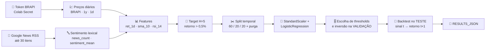
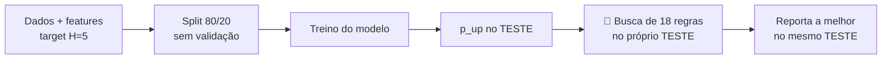

<div align="center">

# 📈 Indicadores Técnicos + Sentimento de Notícias para Sinais de Negociação

### Um experimento com validação temporal em ITUB4, PETR4 e VALE3


**Autora:** Giselle de Araujo Brasileiro · **Código:** `pipeline_validacao_temporal_3tickers.py` · **Data:** 30/10/2026

*Como o código foi construído, por que as escolhas foram feitas e o que os resultados significam.*

</div>

> [!WARNING]
> Este projeto é um **experimento acadêmico**. Não é aconselhamento financeiro, não envia ordens reais à bolsa e os resultados históricos **não são promessa de desempenho futuro**.

---

## 📑 Sumário

1. [**Resumo**](#1--resumo)
2. [**Introdução**](#2--introdução)
   - [Pergunta de pesquisa](#21-pergunta-de-pesquisa)
   - [Vocabulário](#22-vocabulário)
3. [**Modelagem**](#3-️-modelagem)
   - [Arquitetura do pipeline](#31-arquitetura-do-pipeline)
   - [Organização do código](#32-organização-do-código)
   - [Parâmetros do experimento](#33-parâmetros-do-experimento)
   - [Construção dos dados](#34-construção-dos-dados)
   - [Definição do alvo](#35-definição-do-alvo)
   - [Divisão temporal e modelo](#36-divisão-temporal-e-modelo)
   - [Regra de negociação](#37-regra-de-negociação-buy--sell--hold)
   - [Backtest](#38-backtest)
4. [**Resultados**](#4--resultados)
   - [Baseline D+1](#41-baseline-d1)
   - [Evolução experimental](#42-evolução-experimental)
   - [Execução anterior](#43-execução-anterior)
   - [Execução atual](#44-execução-atual-validação-temporal)
   - [Comparação anterior × atual](#45-comparação-anterior--atual)
5. [**Conclusão e Trabalhos Futuros**](#5--conclusão-e-trabalhos-futuros)
- [Apêndice — Como executar no Colab](#-apêndice--como-executar-no-colab)

---

## 1. 🧾 Resumo

Este trabalho explica não apenas **quais números apareceram**, mas **como o programa foi pensado e implementado**. O protótipo baixa **preços** e **notícias**, transforma essas fontes em variáveis, define um resultado futuro a classificar, ajusta um modelo, **escolhe uma regra de negociação na validação** e mede essa regra num **bloco posterior de teste**. O fluxo foi aplicado a **ITUB4, PETR4 e VALE3**.

| Ticker | Estratégia (teste) | Buy & Hold (teste) | Veredito |
|:------:|:------------------:|:------------------:|:---------|
| **ITUB4** | 1,0758 (**+7,58%**) | 1,2588 (**+25,88%**) | 🔴 Abaixo do benchmark |
| **PETR4** | 1,3218 (**+32,18%**) | 1,3612 (**+36,12%**) | 🔴 Abaixo do benchmark |
| **VALE3** | 1,0000 (**0,00%**) | 0,8582 (**−14,18%**) | ⚪ Sem posição durante a queda |

> [!IMPORTANT]
> - Na nova execução, **ITUB4 e PETR4 ficaram abaixo do Buy & Hold** no teste.
> - **VALE3 não abriu posição** e terminou em fator 1,0 durante uma queda do benchmark — isso não demonstra uma estratégia ativa lucrativa.
> - A separação treino/validação/teste melhora a disciplina experimental, mas permanece uma limitação: o modelo prevê o retorno de **5 pregões**, enquanto o backtest aplica o sinal ao retorno do **dia seguinte**.

---

## 2. 📘 Introdução

### 2.1 Pergunta de pesquisa

> É possível combinar indicadores de preço e notícias para gerar sinais simulados de **compra (BUY)**, **saída (SELL)** ou **manutenção (HOLD)**, e como esses sinais se comparam a comprar a ação no início e mantê-la?

A resposta deve ser vista como um **experimento acadêmico**, não como aconselhamento financeiro ou promessa de desempenho.

A investigação foi feita de forma iterativa: partiu de um **baseline D+1** (prever a direção do próximo dia), migrou as fontes de dados para **BRAPI + Google News RSS** para rodar de forma leve no Colab, testou um horizonte de **5 pregões** e, por fim, adotou **validação temporal** com treino, validação e teste separados. A trajetória completa está em [Evolução experimental](#42-evolução-experimental).

### 2.2 Vocabulário

| Termo | Explicação sem jargão |
|---|---|
| **Ticker** | Código que identifica a ação, por exemplo `PETR4`. |
| **Feature** | Dado numérico que o modelo recebe: retorno, RSI, número de notícias etc. |
| **Target / alvo** | A resposta que queremos que o modelo estime. |
| **Treino** | Período antigo usado para ajustar o modelo. |
| **Validação** | Período usado para escolher a regra/limiares antes da avaliação final. |
| **Teste** | Período posterior reservado para medir a regra já escolhida. |
| **Threshold / limiar** | Corte de probabilidade que decide quando entrar ou sair da posição. |
| **Backtest** | Simulação histórica de uma regra; não coloca ordens na bolsa. |
| **Buy & Hold** | Comprar no começo e manter; referência de comparação. |
| **Overfitting** | Quando as escolhas se ajustam demais ao histórico e não generalizam. |
| **Purga** | Intervalo removido entre blocos para que rótulos futuros não atravessem a fronteira. |

> [!TIP]
> **Fatores de patrimônio** começam em 1. Um fator de 1,20 = 1,20× o patrimônio inicial (+20%); 0,90 = terminar 10% abaixo do início. Não são porcentagens escritas diretamente.

---

## 3. ⚙️ Modelagem

### 3.1 Arquitetura do pipeline



### 3.2 Organização do código

O código foi organizado em **funções pequenas**, cada uma com uma responsabilidade fácil de testar. Se a fonte de preços mudar, revisa-se só a função de preços; se a regra de decisão mudar, altera-se o backtest sem mexer no parser RSS.

| Função / bloco | O que faz | Por que foi separado assim |
|---|---|---|
| `Configuração` | Define tickers, horizonte, fonte, grids e custo. | Deixa as escolhas experimentais visíveis e reproduzíveis. |
| `get_brapi_token` | Busca o segredo do Colab ou solicita o token escondido. | Evita escrever credencial no código público. |
| `brapi_quote_historical` | Baixa e limpa fechamentos diários. | Isola a integração de preço e trata ausência de dados. |
| `rss_url` / `parse_rss` | Monta a consulta e extrai campos do XML RSS. | Separa busca de parsing; o parser ainda depende do formato do feed. |
| `simple_sentiment_pt` / `news_features` | Cria o score lexical e agrega notícias por data. | Transforma texto em colunas numéricas simples. |
| `rsi` / `build_features_targets` | Calcula features de preço e o target futuro. | Torna explícita a janela dos indicadores e a variável a prever. |
| `backtest_next_day` | Aplica o sinal da data *t* ao retorno de *t* até *t+1*. | Evita usar o retorno do dia antes de o sinal existir. |
| `choose_thresholds` | Testa combinações na validação e guarda a melhor. | Mantém o teste fora da seleção da regra. |
| `run_one_ticker` / `run` | Executa o fluxo por ativo e imprime JSON. | Permite comparar tickers com saída estruturada. |

### 3.3 Parâmetros do experimento

| Parâmetro | Execução anterior | Execução atual |
|---|:---:|:---:|
| `TICKERS` | ITUB4, PETR4, VALE3 | ITUB4, PETR4, VALE3 |
| `PRICE_RANGE` / `PRICE_INTERVAL` | `"1y"` / `"1d"` | `"1y"` / `"1d"` |
| `RSS_ITEMS_PER_TICKER` | 30 | 30 |
| `HORIZON_DAYS` | 5 | 5 |
| `RET_THRESHOLD` | 0.005 | 0.005 |
| `FILTER_NEUTRAL` | `False` | `False` |
| Divisão | `TRAIN_FRAC=0.80` (treino/teste) | 60% / 20% / 20% (treino/validação/teste) |
| Purga nas fronteiras | — | 5 linhas (`HORIZON_DAYS`) |
| `BUY_GRID` | `[0.55, 0.60, 0.65]` | `[0.55, 0.60, 0.65]` |
| `SELL_GRID` | `[0.45, 0.40, 0.35]` | `[0.45, 0.40, 0.35]` |
| `FEE_PER_TRADE` | 0.0005 | 0.0005 |
| Onde a regra é escolhida | 🔴 no **teste** | 🟢 na **validação** |

### 3.4 Construção dos dados

#### 💹 Preços — BRAPI

`brapi_quote_historical` chama a BRAPI com `PRICE_RANGE="1y"` e `PRICE_INTERVAL="1d"`. O código conserva **data** e **close**, converte o preço para número, remove fechamentos ausentes e ordena as datas. Se a fonte não retornar preços ou faltar uma coluna esperada, devolve uma tabela vazia, evitando falhas silenciosas adiante.

> [!CAUTION]
> O token é uma credencial. Ele é lido do Secret `BRAPI_TOKEN` do Colab (ou digitado sem eco) e **nunca** deve aparecer no relatório, README, notebook público ou repositório.

#### 📰 Notícias — Google News RSS

`rss_url` monta a consulta com o ticker como termo; `parse_rss` usa um parser XML para percorrer os itens e recuperar **título, descrição, data e link**. Se o XML não puder ser lido, retorna tabela vazia com as colunas esperadas. O limite é de **30 notícias por ticker**, para reduzir volume e tempo.

> [!NOTE]
> O RSS **não é uma base histórica completa**. Os itens e datas variam com o tempo e, ao combinar as notícias com todo o histórico de preço, muitas datas antigas ficam sem notícia associada (recebem zero). O modelo **não** teve uma série de sentimento completa e comparável ao preço durante todo o ano.

#### 🔤 Do texto aos números

`simple_sentiment_pt` limpa pontuação, separa palavras e verifica se cada termo está numa lista pequena de vocabulário positivo ou negativo:

```math
\text{score} = \frac{\text{positivas} - \text{negativas}}{\text{total reconhecido}}
```

Exemplo: 2 positivas e 1 negativa → $(2-1)/(2+1) = 1/3$. Sem palavras reconhecidas, o denominador mínimo evita divisão por zero e o score é zero. `news_features` agrega por data, gerando `news_count` e `sentiment_mean`.

O método foi escolhido por **simplicidade, velocidade e explicabilidade**, mas não entende negação (“não subiu”), ironia, contexto, duplicatas, relevância nem relações semânticas. É uma *baseline* didática, não análise financeira de sentimentos validada.

#### 📊 Indicadores de preço

| Variável | Como ler | Decisão de projeto |
|---|---|---|
| `ret_1d` | Variação do fechamento em relação ao pregão anterior. | Captura o movimento recente de um dia. |
| `sma_10` | Média dos dez fechamentos mais recentes. | Suaviza oscilações curtas. |
| `rsi_14` | Movimentos recentes de alta e baixa numa janela de 14. | Informação sintética de *momentum*. |
| `news_count` | Quantidade de notícias na data. | Volume de cobertura como sinal simples. |
| `sentiment_mean` | Média dos scores lexicais do dia. | Orientação lexical rudimentar. |

### 3.5 Definição do alvo

**Baseline D+1.** A primeira hipótese era prever se o próximo dia teria retorno positivo — fácil de entender, mas os movimentos diários têm muito ruído (ver [resultados do baseline](#41-baseline-d1)).

**Horizonte H=5 com margem de 0,5%.** O programa calcula o fechamento cinco pregões à frente com `shift(-HORIZON_DAYS)`:

```math
r_H(t) = \frac{\text{close}(t+5)}{\text{close}(t)} - 1
\qquad\qquad
y_t =
\begin{cases}
1 & \text{se } r_H(t) > 0{,}005 \\
0 & \text{caso contrário}
\end{cases}
```

- `FILTER_NEUTRAL=False`: pequenas altas, estabilidade e quedas que não ultrapassam a margem ficam na classe 0.
- As últimas datas **sem preço futuro ficam sem target e são removidas**.
- A **purga de 5 linhas** antes de cada fronteira impede que a janela de rotulagem invada o bloco seguinte.

A hipótese era reduzir o ruído de tentar acertar exatamente o próximo dia. Isso não garante melhor previsão: **altera a pergunta** do experimento e a distribuição dos rótulos.

### 3.6 Divisão temporal e modelo

```text
|◄──────── 60% treino ────────►|purga|◄─ 20% validação ─►|purga|◄─ 20% teste ─►|
             passado  ───────────────────────────────────────────►  futuro
```

- `train_cut` separa os primeiros 60% para treino e `validation_cut` marca o fim dos 20% seguintes; o restante é teste.
- A ordem passado → futuro é respeitada (sem embaralhamento aleatório).
- `StandardScaler` é ajustado **só no treino** e aplicado à validação e ao teste, para que estatísticas do futuro não influenciem o treino.
- `LogisticRegression` é um classificador binário simples que aprende pesos e produz `p_up`, a probabilidade estimada da classe positiva.

**Métricas de classe ≠ backtest.** Com corte fixo de 0,5, `p_up` vira classe prevista e é comparada ao target:

| Métrica | O que mede |
|---|---|
| Accuracy | Proporção de acertos. |
| Precision | Acertos entre as previsões positivas. |
| Recall | Positivos reais encontrados. |
| F1 | Combinação de precision e recall. |
| ROC-AUC | Ordenação de positivos versus negativos. |

Essas métricas avaliam a **classificação**, não o retorno financeiro da regra.

### 3.7 Regra de negociação (BUY / SELL / HOLD)

| Condição | Ação |
|---|---|
| `p ≥ buy_thr` | 🟢 **BUY** — abre posição |
| `p ≤ sell_thr` | 🔴 **SELL** — zera posição |
| entre os limiares | 🟡 **HOLD** — mantém a posição anterior |

```python
BUY_GRID  = [0.55, 0.60, 0.65]
SELL_GRID = [0.45, 0.40, 0.35]   # pares com sell >= buy são rejeitados (sem faixa de HOLD)
```

**Inversão e seleção na validação.** O código testa `p_up` e `1 - p_up` (`roc_auc_inverted` mede a versão invertida). `choose_thresholds` roda o backtest de cada combinação **na validação**, guarda a de maior fator de patrimônio e **congela** essa regra para o teste.

> [!NOTE]
> A inversão é apenas uma hipótese para aquele histórico; não prova que a direção oposta persistirá.

### 3.8 Backtest

`backtest_next_day` calcula `next_return = close(t+1)/close(t) - 1` e aplica o sinal de *t* a esse retorno.

- Mudança de posição → patrimônio × `(1 - FEE_PER_TRADE)`.
- Posição comprada mantida → aplica o retorno do dia seguinte.
- Buy & Hold multiplica todos os retornos da mesma janela.
- `trades_approx` conta mudanças de posição (não ordens reais completas).

| ✅ Corrigido | ⚠️ Ainda pendente |
|---|---|
| O sinal não é mais aplicado a um retorno que já aconteceu antes dele. | O target é de **5 dias**, mas a estratégia captura o retorno de **1 dia**. O alinhamento *t → t+1* evita *look-ahead* imediato, mas as duas definições não medem a mesma pergunta econômica. |
| | Custo fixo não representa slippage, spread, impostos, liquidez, execução parcial ou impacto de mercado. Não é simulação de ordens reais. |

> [!TIP]
> A próxima revisão deve **manter a posição até o horizonte H** ou **redefinir o target para o retorno de um dia** — e documentar a escolha.

---

## 4. 📊 Resultados

### 4.1 Baseline D+1

A matriz `[[171, 147], [219, 183]]` (720 observações) segue o formato `[[TN, FP], [FN, TP]]`.

|  | Previsto 0 | Previsto 1 |
|---|:---:|:---:|
| **Real 0** | TN = 171 | FP = 147 |
| **Real 1** | FN = 219 | TP = 183 |

| Métrica | Valor | Significado |
|---|:---:|---|
| Accuracy | 0,4917 | Fração de observações classificadas corretamente. |
| Precision | 0,5545 | Das previsões positivas, fração realmente positiva. |
| Recall | 0,4552 | Dos positivos reais, fração encontrada. |
| Specificity | 0,5377 | Dos negativos reais, fração reconhecida. |
| F1-score | 0,5000 | Equilíbrio entre precision e recall. |
| Balanced accuracy | 0,4965 | Média de recall e especificidade. |
| MCC | −0,0070 | Correlação previsão × rótulo; ≈ 0 indica associação fraca. |
| FPR | 0,4623 | Negativos marcados como positivos. |
| FNR | 0,5448 | Positivos reais perdidos. |
| ROC-AUC | 0,5077 | Próxima do nível aleatório (0,5). |

<details>
<summary>🧮 Conferência dos cálculos (valores completos)</summary>

```text
accuracy  = (TN + TP) / total = (171 + 183) / 720 = 0.49166666666666664
precision = TP / (TP + FP)    = 183 / (183 + 147) = 0.5545454545454546
recall    = TP / (TP + FN)    = 183 / (183 + 219) = 0.4552238805970149
F1        = 2·P·R / (P + R)                      = 0.5

specificity       = 0.537735849056604
balanced accuracy = 0.496479864826809
MCC               = -0.007016598874448
FPR               = 0.462264150943396
FNR               = 0.544776119402985
ROC-AUC           = 0.5076895397227698
```

</details>

> [!NOTE]
> Esta matriz é do baseline **D+1** e não deve ser confundida com as matrizes **H=5** da execução atual: ITUB4 `[[14,6],[9,17]]`, PETR4 `[[4,13],[13,16]]` e VALE3 `[[0,37],[0,9]]`.

### 4.2 Evolução experimental

Cada versão alterou uma decisão para investigar uma dificuldade. Os pares de fatores são **estratégia vs Buy & Hold**. Como períodos, tickers, thresholds e critérios mudaram, os números **não** constituem uma comparação controlada única.

| Versão | Hipótese / mudança | Resultados (estratégia vs B&H) | Aprendizado e ressalva |
|---|---|---|---|
| **Baseline D+1** | Prever a direção do próximo dia. | accuracy 0,4917 · AUC 0,5077 · matriz `[[171,147],[219,183]]` | AUC ≈ 0,5 e accuracy < 0,5 motivaram outro alvo. |
| **Migração de dados** | BRAPI + Google News RSS para rodar leve no Colab, após limitações das tentativas anteriores. | Preços BRAPI; notícias RSS. | Menos barreiras de execução, mas o RSS não forma série histórica completa. |
| **Leve v2 (ITUB4)** | Alvo H=5, thresholds e diagnóstico de sinal invertido. | AUC 0,8557 · 1,3480 vs 1,1837 · 1 trade | Promissor, mas limiares escolhidos no teste — não era avaliação independente. |
| **V3 — walk-forward** | Treino/validação/teste temporal; 2y, RSS 60, `min_trades` 2. | ITUB4 1,0967 vs 1,2500 · PETR4 1,1000 vs 1,2113 · VALE3 1,1116 vs 0,8429 | Reduz ajuste ao teste; evidencia diferenças entre ativos. |
| **V4 — thresholds globais** | Regra única no portfólio: buy 0,55 / sell 0,45. | ITUB4 1,0956 vs 1,2488 · PETR4 1,0391 vs 1,2087 · VALE3 1,0814 vs 0,8430 | Simples, mas pode não se adaptar a cada ativo. |
| **V5 — não piorar ativos** | Critério na validação para não piorar nenhum ativo. | ITUB4 1,2845 vs 1,2537 · PETR4 1,0974 vs 1,2085 · VALE3 1,1116 vs 0,8475 | Não gerou superioridade em todos. |
| **V6 — maximin** | Priorizar na validação o pior ticker. | ITUB4 1,2748 vs 1,2443 · PETR4 1,0895 vs 1,1998 · VALE3 1,1116 vs 0,8481 | Proteger o pior caso não bastou. |
| **V7 / V7.1 — PETR4** | Horizontes e limiares para PETR4; seleção pela validação. | Melhor V7.1: 1,0818 vs 1,2071 · H=10 visto no teste: 1,2290 vs 1,2071 (6 trades) | Configuração vista no teste não deve virar vencedora retrospectivamente. |
| **Final anterior** | H=5, grid de thresholds/inversão escolhido no teste. | ITUB4 1,1848 vs 1,1913 · PETR4 1,3650 vs 1,3413 · VALE3 0,9852 vs 0,8920 | Viés de seleção e otimismo potencial. |
| **✅ Revisada** | 60/20/20, purga H, thresholds na validação, sinal *t → t+1*. | [Ver 4.4](#44-execução-atual-validação-temporal) | Seleção mais limpa; falta alinhar H=5 ao backtest diário. |

<details>
<summary>🔢 Valores completos da evolução experimental</summary>

<br>

| Versão | Valores registrados |
|---|---|
| Baseline D+1 | accuracy=0.49166666666666664; ROC-AUC=0.5076895397227698 |
| Leve v2 (ITUB4) | ROC-AUC=0.8556521739130435; final_strategy=1.348032657957878; Buy & Hold=1.1836686944314467 |
| V3 | ITUB4 1.0966828809115032 vs 1.2499999999999996; PETR4 1.1000219170377215 vs 1.2113459399332591; VALE3 1.111607702106226 vs 0.8429141958126577 |
| V4 | ITUB4 1.0955894782386104 vs 1.2487537387836487; PETR4 1.0390643808276419 vs 1.2086763070077864; VALE3 1.0813698715747515 vs 0.8430352172334491 |
| V5 | ITUB4 1.28447190843006 vs 1.2537387836490523; PETR4 1.0973956020842797 vs 1.2084538375973302; VALE3 1.111607702106226 vs 0.8475130098027339 |
| V6 | ITUB4 1.274768144509515 vs 1.244267198404785; PETR4 1.0895166572239543 vs 1.1997775305895437; VALE3 1.111607702106226 vs 0.8481181169066913 |
| V7.1 | Best 1.081769689124918 vs 1.207119021134594; H=10 no teste 1.22902842297186 vs 1.207119021134594 |
| Final anterior | ITUB4 1.1847522449526409 vs 1.1912502988285931; PETR4 1.3649836662346402 vs 1.3413244718727741; VALE3 0.985232617679185 vs 0.8920281204403763 |

</details>

### 4.3 Execução anterior

Arquivo: `pipeline_leve_janela_v2_3tickers.py`, executado antes do código temporal revisado.



#### Resultados

| Ticker | Accuracy | Precision | Recall | F1 | ROC-AUC | AUC inv. | Matriz | Invert / buy / sell | Estratégia | B&H | Trades |
|:---:|:---:|:---:|:---:|:---:|:---:|:---:|:---:|:---:|:---:|:---:|:---:|
| ITUB4 | 0,7234 | 0,9444 | 0,5862 | 0,7234 | 0,7548 | 0,2452 | `[[17,1],[12,17]]` | true / 0,65 / 0,45 | 1,1848 | 1,1913 | 3 |
| PETR4 | 0,4043 | 0,5294 | 0,3103 | 0,3913 | 0,3046 | 0,6954 | `[[10,8],[20,9]]` | true / 0,55 / 0,40 | 1,3650 | 1,3413 | 3 |
| VALE3 | 0,3617 | 0,2571 | 0,6923 | 0,3750 | 0,4955 | 0,5045 | `[[8,26],[4,9]]` | true / 0,55 / 0,40 | 0,9852 | 0,8920 | 5 |

<details>
<summary>🔢 Valores completos da execução anterior</summary>

<br>

| Ticker | Accuracy | Precision | Recall | F1 | ROC-AUC | AUC invertida | Estratégia | Buy & Hold |
|---|---|---|---|---|---|---|---|---|
| ITUB4 | 0.723404255319149 | 0.9444444444444444 | 0.5862068965517241 | 0.723404255319149 | 0.7547892720306514 | 0.24521072796934865 | 1.1847522449526409 | 1.1912502988285931 |
| PETR4 | 0.40425531914893614 | 0.5294117647058824 | 0.3103448275862069 | 0.391304347826087 | 0.30459770114942525 | 0.6954022988505748 | 1.3649836662346402 | 1.3413244718727741 |
| VALE3 | 0.3617021276595745 | 0.2571428571428571 | 0.6923076923076923 | 0.375 | 0.49547511312217196 | 0.504524886877828 | 0.985232617679185 | 0.8920281204403763 |

</details>

#### Interpretação por ativo

- **ITUB4:** a matriz `[[17,1],[12,17]]` mostra 17 negativos corretos, 1 falso positivo, 12 falsos negativos e 17 positivos encontrados. A precision (0,94) era alta, mas o recall (0,59) deixava muitos positivos sem identificação. A ROC-AUC (0,75) parecia favorável, porém a estratégia ficou **ligeiramente abaixo** do Buy & Hold — a classificação não se traduziu em vantagem de patrimônio.
- **PETR4:** AUC original 0,30 (abaixo de 0,5) e invertida 0,70. O grid usou inversão e a estratégia superou o benchmark (1,3650 vs 1,3413), mas, como a regra foi escolhida **para maximizar esse mesmo teste**, a diferença não é confirmação independente.
- **VALE3:** AUCs ≈ 0,5. A estratégia terminou **≈ 1,48% abaixo** do capital inicial, enquanto o benchmark caiu **≈ 10,80%**. Caiu menos, mas **perdeu valor absoluto** — dizer só que “superou o benchmark” esconderia isso.

<details>
<summary><b>🔍 Como o script anterior funcionava — passo a passo</b></summary>

<br>

1. **Configuração:** `TICKERS` = ITUB4, PETR4, VALE3; `PRICE_RANGE="1y"`; `PRICE_INTERVAL="1d"`; `RSS_ITEMS_PER_TICKER=30`; `HORIZON_DAYS=5`; `RET_THRESHOLD=0.005`; `TRAIN_FRAC=0.80`. Ou seja: até um ano de fechamentos diários (não significa que todos os dias corridos tenham pregão), no máximo 30 notícias por ativo e um rótulo futuro de cinco pregões com margem de 0,5%.
2. **Coleta do preço:** `brapi_quote_historical` consultava o endpoint de cotação histórica da BRAPI, selecionava `date` e `close`, convertia timestamp para data e ordenava. Sem resultado, retornava tabela vazia e `run_one_ticker` informava erro do ticker e passava ao próximo.
3. **Coleta de notícia:** `build_google_news_rss_url` montava a consulta do Google News RSS com o ticker; `parse_rss` separava item, título, data, descrição e link **por expressões regulares**. Itens acima do limite eram cortados para manter 30 — não 30 por dia, mas até 30 retornados pela consulta naquele momento.
4. **Sentimento:** `simple_sentiment_pt` formava um texto com título + descrição, limpava pontuação, separava palavras e contava termos em `POS_WORDS` e `NEG_WORDS`. O score (positivos − negativos) / total classificado era resumido por dia. Sem contexto, negação, ironia ou tratamento de duplicidade.
5. **Features e target:** `pct_change` gerava `ret_1d`; `sma_10` e `rsi_14` eram calculados; `news_count` e `sentiment_mean` eram associados por data (dias sem notícia recebiam zero). `future_ret_H` deslocava `close` cinco linhas à frente e `target_up_H=1` quando o retorno excedia 0,005.
   > ⚠️ O `future_close` inexistente no fim da série podia produzir comparação falsa e **virar classe 0** — o rótulo não era preservado como ausente. A versão revisada corrigiu isso.
6. **Divisão:** após retirar linhas com features ausentes, `cut = floor(n * 0.80)`. As primeiras 80% iam para treino e as últimas 20% para teste. O teste era cronologicamente posterior, mas **não havia bloco de validação**.
7. **Treino e métricas:** `StandardScaler` ajustado em `X_train` e aplicado a treino/teste; `LogisticRegression` ajustada com `y_train`. `predict_proba(X_test)` gerava `p_up`. Com corte 0,5 (`p_up >= 0.5`), obtinham-se TN, FP, FN, TP e as métricas; `roc_auc` media `p_up` e `roc_auc_inverted` media `1 - p_up`. A ROC-AUC não depende do corte 0,5: avalia a ordenação ao variar o limiar.
8. **Busca da regra:** varria `invert` False/True × `buy_grid` × `sell_grid` — **18 possibilidades**, descartando `sell >= buy` — executando `backtest_probs` para cada combinação **na própria tabela `test_bt`**, e guardava a de maior `final_strategy`.
9. **Backtest anterior:** `test_bt` guardava `date`, `close` e `p_up`. `backtest_probs` calculava `ret_1d` **na mesma linha** e atualizava a posição pelo limiar; descontava `FEE_PER_TRADE=0.0005` a cada mudança de posição (contada em `trades_approx`) e comparava com o Buy & Hold do mesmo segmento. Sem slippage, spread, liquidez nem execução real.
10. **Consequência metodológica:** como a regra foi escolhida pelo retorno do teste e reportada nesse mesmo teste, o resultado **não era uma medição imparcial fora da amostra**. Entre muitas combinações, alguma pode vencer por acaso; escolher a vencedora depois de olhar o teste produz **viés de seleção/otimismo**.

</details>

<details>
<summary><b>🎓 Perguntas prováveis da banca sobre a execução anterior</b></summary>

<br>

| Pergunta | Resposta |
|---|---|
| O modelo escolheu thresholds antes de ver o teste? | Não. Calculava os retornos das combinações diretamente em `test_bt` e escolhia a maior `final_strategy`. |
| Então o teste era independente? | Não para o backtest: os mesmos dados influenciaram a escolha da regra. As métricas com corte 0,5 e o retorno da regra respondem análises diferentes. |
| Por que há ROC-AUC original e invertida? | Uma usa `p_up`; a outra, `1 - p_up`. Ambas foram testadas no próprio teste ao escolher a regra. |
| As 30 notícias cobrem o ano inteiro? | Não. É um limite de itens RSS consultados, não um arquivo histórico diário anual. |
| O futuro inexistente no fim foi removido? | Não de forma explícita e segura; a versão revisada mantém o target ausente e descarta essas linhas. |
| O retorno do backtest é uma ordem real? | Não. É simulação simplificada com custo fixo por mudança de posição. |
| Dá para comparar as execuções como experimento isolado? | Não diretamente. Mudaram seleção, tratamento de targets, purga e alinhamento do backtest; os dados consultados também podem ter mudado. |

</details>

### 4.4 Execução atual (validação temporal)

Cada ticker tem **133 linhas de treino, 41 de validação e 46 de teste**. A matriz de confusão soma 46; o backtest tem **45 retornos**, porque a última data do teste não tem fechamento seguinte dentro do bloco.

#### Classificação no teste

| Ticker | Accuracy | Precision | Recall | F1 | ROC-AUC | AUC invertida | Matriz `[[TN,FP],[FN,TP]]` |
|:---:|:---:|:---:|:---:|:---:|:---:|:---:|:---:|
| **ITUB4** | 0,6739 | 0,7391 | 0,6538 | 0,6939 | **0,8442** | 0,1558 | `[[14, 6], [9, 17]]` |
| **PETR4** | 0,4348 | 0,5517 | 0,5517 | 0,5517 | 0,3590 | **0,6410** | `[[4, 13], [13, 16]]` |
| **VALE3** | 0,1957 | 0,1957 | 1,0000 | 0,3273 | 0,4054 | 0,5946 | `[[0, 37], [0, 9]]` |

#### Regra escolhida na validação e backtest no teste

| Ticker | Regra (validação) | Estratégia / B&H na validação | Trades val. | Estratégia teste | B&H teste | Trades teste |
|:---:|:---:|:---:|:---:|:---:|:---:|:---:|
| **ITUB4** | invert=`false` · buy 0,55 · sell 0,45 | 1,0654 / 0,9642 | 2 | 1,0758 | **1,2588** | 4 |
| **PETR4** | invert=`true` · buy 0,55 · sell 0,40 | 1,1002 / 1,0810 | 3 | 1,3218 | **1,3612** | 4 |
| **VALE3** | invert=`true` · buy 0,55 · sell 0,45 | 1,0000 / 0,9136 | 0 | **1,0000** | 0,8582 | 0 |

<sub>Valores arredondados para 4 casas; os completos estão nos detalhes por ativo.</sub>

#### Conferência dos valores do teste

| Ticker | Contagem da matriz | Conferência de accuracy | Estratégia | Benchmark | Comparação |
|:---:|---|---|:---:|:---:|---|
| ITUB4 | TN=14 · FP=6 · FN=9 · TP=17 | (14+17)/46 = 0,6739 | 1,0758 | 1,2588 | 🔴 Abaixo do benchmark |
| PETR4 | TN=4 · FP=13 · FN=13 · TP=16 | (4+16)/46 = 0,4348 | 1,3218 | 1,3612 | 🔴 Abaixo do benchmark |
| VALE3 | TN=0 · FP=37 · FN=0 · TP=9 | (0+9)/46 = 0,1957 | 1,0000 | 0,8582 | ⚪ Sem posição; preservou valor na queda |

Fórmulas: accuracy = (TN+TP)/(TN+FP+FN+TP) · precision = TP/(TP+FP) · recall = TP/(TP+FN). A matriz do scikit-learn tem **linhas = classe real** e **colunas = classe prevista** (com `labels=[0,1]`).

> [!NOTE]
> A ROC-AUC usa probabilidades contínuas, portanto **não pode ser recalculada** só com as quatro contagens da matriz.

#### Interpretação por ativo

<details>
<summary><b>🏦 ITUB4</b> — boa ordenação, mas abaixo do Buy & Hold</summary>

<br>

- **Classificação:** accuracy=0.6739130434782609 · precision=0.7391304347826086 · recall=0.6538461538461539 · F1=0.6938775510204082 · ROC-AUC=0.8442307692307692 · AUC invertida=0.1557692307692308
- **Matriz:** TN 14 · FP 6 · FN 9 · TP 17
- **Validação:** `invert_signal=false`, `buy_thr=0.55`, `sell_thr=0.45` → estratégia 1.065435618912237 vs B&H 0.9641532756489496 (2 trades)
- **Teste:** `final_strategy=1.075753936237348` vs `final_buy_hold=1.258795934323691` (4 trades)

A ROC-AUC sugere boa ordenação neste conjunto, mas **precisão classificatória não garante retorno superior**.
</details>

<details>
<summary><b>🛢️ PETR4</b> — inversão escolhida na validação, ainda abaixo do Buy & Hold</summary>

<br>

- **Classificação:** accuracy=0.43478260869565216 · precision=0.5517241379310345 · recall=0.5517241379310345 · F1=0.5517241379310345 · ROC-AUC=0.35902636916835695 · AUC invertida=0.640973630831643
- **Matriz:** TN 4 · FP 13 · FN 13 · TP 16
- **Validação:** `invert_signal=true`, `buy_thr=0.55`, `sell_thr=0.4` → estratégia 1.10019730948507 vs B&H 1.0809548521017127 (3 trades)
- **Teste:** `final_strategy=1.3218431606508754` vs `final_buy_hold=1.3611691022964503` (4 trades)

A AUC invertida é maior que a original e a validação escolheu inversão; mesmo assim, a estratégia ficou abaixo do benchmark.
</details>

<details>
<summary><b>⛏️ VALE3</b> — classificador degenerado, nenhuma operação</summary>

<br>

- **Classificação:** accuracy=0.1956521739130435 · precision=0.1956521739130435 · recall=1.0 · F1=0.32727272727272727 · ROC-AUC=0.4054054054054054 · AUC invertida=0.5945945945945945
- **Matriz:** TN 0 · FP 37 · FN 0 · TP 9
- **Validação:** `invert_signal=true`, `buy_thr=0.55`, `sell_thr=0.45` → estratégia 1.0 vs B&H 0.9135559921414531 (0 trades)
- **Teste:** `final_strategy=1.0` vs `final_buy_hold=0.8581727436572849` (0 trades)

Com TN=0 e FN=0, o classificador previu **classe positiva nas 46 observações** (37 falsos positivos e 9 verdadeiros positivos). Recall=1,0 aqui **não** indica bom classificador; accuracy e AUC apontam problema. O backtest ficou em 1,0 por **permanecer fora do mercado durante a queda**, não por ganhos em trades.
</details>

#### Como ler o `RESULTS_JSON`

| Campo | Significado |
|---|---|
| `parameters.horizon_days=5`, `ret_threshold=0.005` | Qual target foi construído. |
| `price_range="1y"`, `rss_items_limit=30` | Configurações de entrada. |
| `train_rows=133`, `validation_rows=41`, `test_rows=46` | Observações por bloco, após features, target conhecido e purga (por ticker). |
| `test_metrics` | Previsões binárias com corte fixo 0,5 (não usa `buy_thr`/`sell_thr`). |
| `confusion_matrix` | Formato `[[TN, FP], [FN, TP]]`. |
| `rule_selected_on_validation` | Inversão e thresholds vencedores, com patrimônio na validação (não é o resultado final). |
| `test_backtest` | Avaliação final no teste com a regra congelada; `n_returns=45`. |
| `interpretation_note` | Lembra que é simulação histórica e que target e backtest devem ser alinhados. |

### 4.5 Comparação anterior × atual

#### O que mudou no protocolo

| Fase | Execução anterior | Execução atual | Por que importa |
|---|---|---|---|
| **Dados e ativos** | BRAPI + RSS; 3 tickers; 1 ano; até 30 itens. | Igual. | RSS continua sem histórico anual completo. |
| **Features e target** | `ret_1d`, SMA10, RSI14, notícias; H=5 e 0,005; datas sem futuro podiam virar classe 0. | Target sem futuro vira `NaN` e é removido; purga de 5 linhas nas fronteiras. | Não conta como queda um futuro desconhecido; reduz sobreposição de rótulos. |
| **Divisão** | 80% treino / 20% teste. | 60% treino / 20% validação / 20% teste. | A validação é o lugar próprio para escolher a regra. |
| **Thresholds / inversão** | Escolhidos **no próprio teste**. | Escolhidos **na validação** e congelados. | Reduz viés de seleção (não elimina incerteza de amostra ou do RSS). |
| **Métricas** | Corte 0,5 no teste. | Corte 0,5 no teste. | Só comparáveis com dados e rótulos equivalentes. |
| **Retorno do backtest** | Retorno da própria linha avaliada. | Sinal em *t* aplicado a *t → t+1*. | Melhor alinhamento, mas H=5 ≠ 1 dia. |
| **Avaliação / benchmark** | Mesmo trecho que escolheu a regra. | Trecho de teste, com regra congelada. | Avaliação mais defensável, mas com protocolo diferente. |

#### Fatores de patrimônio

| Ticker | Anterior: estratégia | Anterior: B&H | Atual: estratégia | Atual: B&H |
|:---:|:---:|:---:|:---:|:---:|
| **ITUB4** | 1,1848 | 1,1913 | 1,0758 | 1,2588 |
| **PETR4** | 1,3650 | 1,3413 | 1,3218 | 1,3612 |
| **VALE3** | 0,9852 | 0,8920 | 1,0000 | 0,8582 |

> [!WARNING]
> Seleção, alinhamento do retorno, data dos preços e itens RSS mudaram ao mesmo tempo. A diferença **não** pode ser atribuída a uma única mudança — a nova execução é um **novo protocolo**, não uma simples correção numérica da anterior.

---

## 5. 🧭 Conclusão e Trabalhos Futuros

### Conclusão

A versão revisada **melhora a disciplina de seleção** ao escolher thresholds na validação e avaliar no teste. Nesta rodada, **não houve superioridade ao Buy & Hold** em ITUB4 e PETR4, e o resultado de VALE3 correspondeu a **nenhuma exposição** durante uma queda.

> **Não há demonstração de uma estratégia que supere de forma consistente o Buy & Hold nos três ativos.**

### Limitações

| Limitação | Impacto |
|---|---|
| Target de 5 pregões × backtest de 1 dia | Classificador e estratégia respondem a perguntas econômicas diferentes. |
| Uma única divisão com 46 linhas de teste | Pouca evidência sobre robustez. |
| RSS sem histórico completo | Série de sentimento esparsa e não comparável ao preço ao longo do ano. |
| Sentimento lexical simples | Não capta negação, ironia, contexto nem relevância. |
| Custo fixo por trade | Ignora slippage, spread, impostos, liquidez e impacto de mercado. |

### Próximos passos

- [ ] Alinhar o target de cinco pregões ao horizonte de exposição do backtest.
- [ ] Avaliar várias janelas com walk-forward (uma divisão e 46 linhas de teste são limitadas).
- [ ] Construir ou obter uma série de notícias por data coerente com todo o período.
- [ ] Adicionar custos realistas, liquidez e regras operacionais antes de qualquer interpretação econômica.
- [ ] Manter o token fora do código compartilhável, apenas no ambiente.
- [ ] Apresentar fatores e métricas como resultados históricos do experimento, não como promessa futura.

### Trabalhos futuros

Os resultados não demonstraram superioridade consistente em relação ao Buy & Hold, mas o experimento evidenciou limitações específicas cuja correção pode melhorar o desempenho e, principalmente, a **confiabilidade da avaliação**. Propõe-se:

1. **Alinhar** o horizonte do alvo ao período de exposição do backtest.
2. **Ampliar** o histórico e adotar validação walk-forward com múltiplas janelas.
3. **Construir** uma base histórica de notícias coerente com todo o período analisado.
4. **Substituir** o sentimento lexical simples por métodos que considerem contexto, como léxicos financeiros ou modelos de linguagem.
5. **Realizar ablação** para medir a contribuição isolada das notícias.
6. **Comparar** a Regressão Logística com outros classificadores e baselines ingênuos.
7. **Incorporar** custos operacionais realistas e métricas de risco, como **Sharpe** e **drawdown máximo**.

---

## 🚀 Apêndice — Como executar no Colab

1. Abra o [Google Colab](https://colab.research.google.com/) e crie um notebook.
2. No painel **🔑 Secrets**, crie `BRAPI_TOKEN` e conceda acesso ao notebook.
3. Carregue ou cole `pipeline_validacao_temporal_3tickers.py`.
4. Instale as dependências, se necessário:

   ```bash
   pip install pandas numpy scikit-learn requests
   ```

5. Execute e aguarde o `RESULTS_JSON` dos três tickers.
6. Guarde data, código exato, parâmetros, mensagens de erro e o JSON.
7. Confira as contagens de treino/validação/teste; se algum bloco ficar pequeno, aumente `PRICE_RANGE` para `"2y"`.
8. Repita o walk-forward em diferentes datas antes de concluir sobre robustez.

---

<div align="center">

**Giselle de Araujo Brasileiro** · 2026

<sub>Experimento acadêmico · Não constitui recomendação de investimento</sub>

</div>
